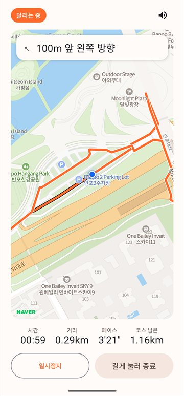
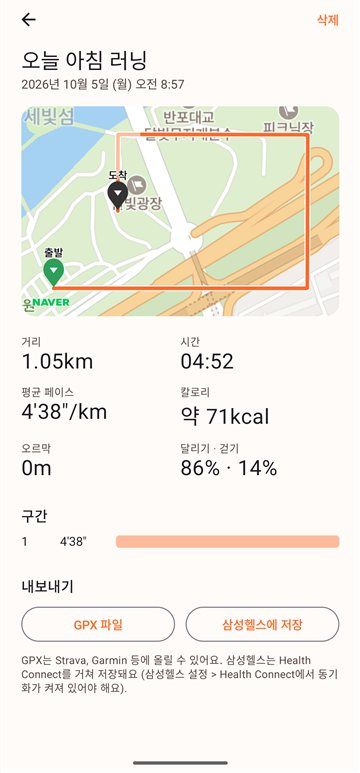
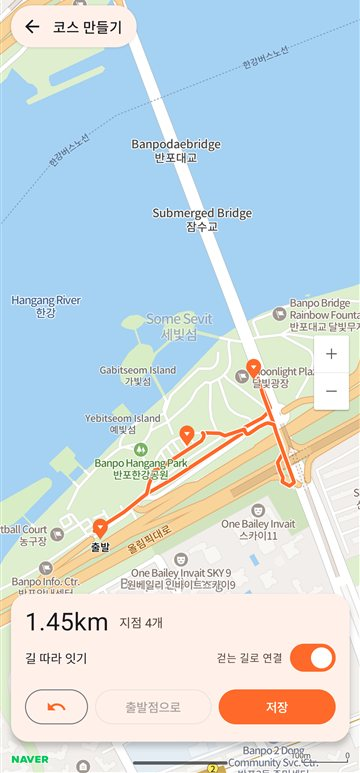
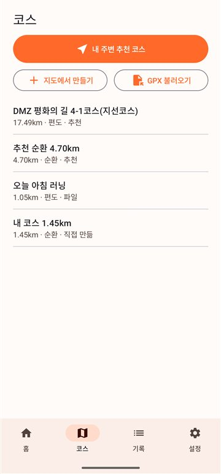
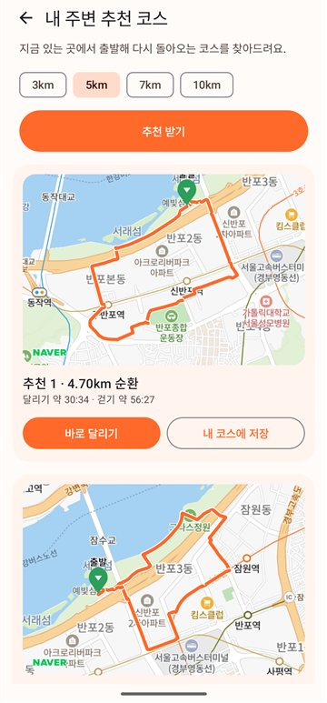
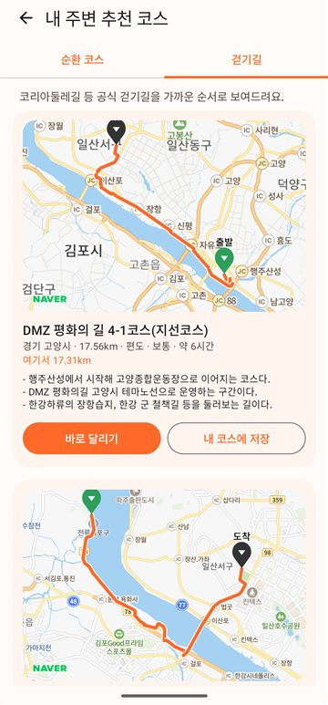
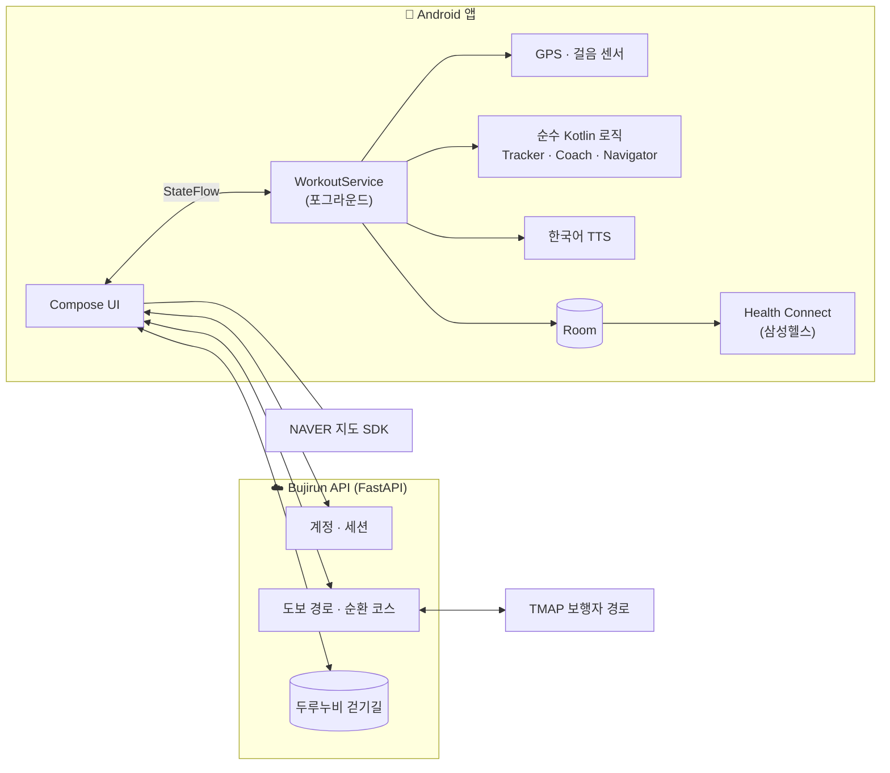

<div align="center">

# 부지런 · Bujirun

**짬 날 때, 이어폰과 폰만 들고.**

워치 없이 폰 하나로 달리고 걷는 사람을 위한 러닝 앱.<br>
음성으로 코칭하고, 코스를 짜주고, 길을 안내합니다.


<br>

   

  

</div>

---

## 왜 만들었나

해외 대회에 나갔을 때, 주최측이 코스를 **Strava 전용**으로 공유하는 바람에 지도 없이 달려야 했습니다.
러닝앱에서 정말 필요한 건 결국 세 가지였습니다.

1. **좋은 코스를 쉽게 찾거나 만드는 것**
2. **달리는 동안 귀로 듣는 안내** - 페이스, 남은 거리, 갈림길
3. **끝나고 남는 기록** - 경로, 구간, 칼로리

부지런은 이 세 가지를 **워치 없이, 폰과 이어폰만으로** 해내는 것을 목표로 합니다.
게임 요소도, 피드도 없습니다. 스스로 달리고 관리하는 사람을 위한 앱입니다.

## 주요 기능

### 🏃 기록과 음성 코칭
- **화면이 꺼져도 정확한 GPS 기록**: 포그라운드 서비스, 튀는 좌표와 정지 중 흔들림 제거
- **걷기/달리기 자동 판별**: 걸음 리듬(케이던스)과 GPS 속도로 판단하고, 10초 이상 유지돼야 상태를 바꿔 신호 대기에 흔들리지 않음
- **자동 일시정지**: 멈춰 서면 3초 뒤 정지, 움직이면 2초 안에 재개
- **한국어 음성 코칭**: 1km 구간, 절반 지점과 예상 완주 시간, 남은 거리, 페이스 목표 대비 "조금 빠르게/천천히". 음악은 끊지 않고 소리만 잠깐 줄임
- **칼로리**: ACSM 대사 공식으로 걷기/달리기와 오르막 경사를 반영해 계산
- **끊김 없는 저장**: 10초마다 저장해서 앱이 강제 종료돼도 기록이 남음

### 🗺️ 코스
- **지도에 점 찍어 만들기**: 점을 찍으면 이전 점과 **실제 도보 경로**로 연결 (TMAP 보행자 경로)
- **GPX 불러오기**: Strava, Garmin, 대회 주최측 파일을 그대로 코스로. 다른 앱에서 "부지런으로 열기"도 가능
- **내 기록을 코스로 저장**
- **내 주변 순환 코스 추천**: 거리(3/5/7/10km)를 고르면 지금 위치에서 출발해 돌아오는 코스를 자동으로 짜줌. 막다른 골목 꼬리와 왕복 구간은 걸러냄
- **공식 걷기길**: 코리아둘레길 139개 코스를 가까운 순으로 (한국관광공사 두루누비)

### 🧭 코스 따라 달리기
- 코스 모양에서 **갈림길을 자동으로 찾아** "100미터 앞에서 왼쪽", "왼쪽입니다" 안내
- 가까운 갈림길은 묶어서: **"오른쪽입니다. 이어서 왼쪽."**
- **코스 이탈/복귀**, 출발점까지 거리, 오르막 예고, 코스 절반·남은 거리·완주 안내
- 운동 중 화면은 내 위치를 따라가는 **실시간 지도**와 다음 안내 배너

### 📤 내보내기
- **GPX 1.1** (Strava, Garmin 업로드용, 일시정지 구간 분리)
- **삼성헬스**: Health Connect로 운동, 경로, 거리, 칼로리 저장

## 구조



- **판단 로직은 모두 순수 Kotlin**입니다. 거리·페이스 계산, 걷기/달리기 판별, 자동 일시정지, 음성 코칭 타이밍, 갈림길 탐지, 길안내가 Android 없이 JVM 테스트로 검증됩니다.
- **지도는 보여주기만, 경로 계산은 서버에서**: 네이버·카카오는 도보 길찾기 API를 공개하지 않아서, 도보 경로는 서버가 TMAP에 물어봅니다. API 키는 서버에만 있고 앱에는 들어가지 않습니다.

## 기술 스택

| 영역 | 사용 기술 |
|---|---|
| 앱 | Kotlin 2.0, Jetpack Compose (Material 3), Coroutines/Flow |
| 위치·센서 | Fused Location Provider, Step Detector, Foreground Service |
| 저장 | Room (마이그레이션 유지, 데이터 삭제 없음) |
| 지도 | NAVER Maps Android SDK 3.23 |
| 음성 | Android TextToSpeech + 오디오 포커스 덕킹 |
| 연동 | Health Connect, GPX 1.1, FileProvider 공유 |
| 서버 | Python 3.11, FastAPI, SQLite, nginx + Let's Encrypt |
| 외부 API | TMAP 보행자 경로, 한국관광공사 두루누비 (공공데이터포털) |

## 프로젝트 구조

```
app/src/main/java/com/mhmh2/bujirun/
├── tracking/   기록 엔진: 필터, 트래커, 걷기/달리기, 자동 일시정지, 칼로리, 가짜 GPS(FakeRun), 서비스
├── coach/      음성 코칭: 목표, 코칭 엔진, 한국어 문장, TTS
├── course/     코스: GPX 파싱·단순화, 갈림길 탐지, 길안내(CourseNavigator), 경로·걷기길 API
├── data/       Room DB, 저장/복구, GPX 내보내기, Health Connect
├── account/    로그인·가입·세션
├── net/        서버 통신
└── ui/         Compose 화면 (홈, 운동 중, 요약, 기록, 코스, 추천, 설정)

backend/
├── server.py   API 엔드포인트
├── accounts.py 계정 (PBKDF2 비밀번호, 세션 토큰)
├── routes.py   TMAP 도보 경로 프록시, 순환 코스 생성
├── trails.py   두루누비 걷기길 동기화·조회
└── deploy/     서버 설치 스크립트와 운영 문서
```

## 빌드

```bash
./gradlew testDebugUnitTest assembleDebug
```

- 디버그 APK는 CPU별로 나뉩니다. 네이버 지도 SDK의 네이티브 코드가 CPU 종류마다 약 23MB씩이기 때문입니다.
  - 폰: `app/build/outputs/apk/debug/app-arm64-v8a-debug.apk`
  - 에뮬레이터: `app/build/outputs/apk/debug/app-x86_64-debug.apk`
- 로컬 서버로 테스트하려면 `-PbujirunApi=http://10.0.2.2:8100/`을 붙여 빌드합니다.
- 네이버 지도 Client ID는 패키지 이름에 묶인 공개 식별자라 `app/build.gradle.kts`에 들어 있습니다. TMAP과 두루누비 키는 **서버에만** 있고 저장소에는 없습니다.

### 서버 (선택)

```bash
cd backend
python -m venv .venv && .venv/bin/pip install -r requirements.txt
TMAP_APP_KEY=... BJ_DATA_DIR=./data .venv/bin/uvicorn server:app --port 8100
DURUNUBI_KEY=... BJ_DATA_DIR=./data .venv/bin/python trails.py sync   # 걷기길 데이터 받기
python -m unittest test_accounts test_routes test_trails
```

## 테스트

| | 테스트 수 | 범위 |
|---|---|---|
| 앱 (JVM) | 73 | GPS 필터, 트래커, 걷기/달리기, 자동 일시정지, 칼로리, 구간, 코칭, 갈림길·길안내, GPX, 가짜 GPS 전체 파이프라인 |
| 서버 | 20 | 계정·중복 가입, 경로 파싱, 순환 코스 생성, 꼬리 제거, 걷기길 동기화·조회 |

에뮬레이터에서는 `adb emu geo fix`로 1초마다 GPS를 넣어 실제 코스를 달리는 것처럼 검증합니다. admin 계정은 가짜 GPS로 1/5/10배속 테스트 운동을 할 수 있습니다.

## 데이터 출처

- 지도: **NAVER Maps**
- 도보 경로: **TMAP** (티맵모빌리티)
- 걷기길 정보: **한국관광공사 두루누비** (공공데이터포털)
- 공원 정보: **공공데이터포털 전국도시공원정보표준데이터**, **© OpenStreetMap 기여자** (공원·호수·하천·공원 산책로)
- 나무 그늘: **ESA WorldCover 2021** (CC BY 4.0)
- 높이(오르막): **Copernicus DEM GLO-30** © DLR e.V. 2010-2014, © Airbus Defence and Space GmbH 2014-2018, provided under COPERNICUS by the European Union and ESA

## 로드맵

- [x] 기록, 음성 코칭, 걷기/달리기 판별, 자동 일시정지, 칼로리
- [x] 기록 저장, GPX, 삼성헬스, 네이버 지도
- [x] 계정 (서버 가입·로그인)
- [x] 코스 만들기, GPX 불러오기, 코스 따라 달리기 (음성 길안내)
- [x] 내 주변 순환 코스 추천, 공식 걷기길
- [x] 공원 코스: 가까운 공원의 산책로를 따라 도는 바퀴 코스
- [x] 그늘길: 코스마다 나무 그늘 비율, 해가 높을 땐 그늘 많은 길 우선 (docs/SHADE.md)
- [x] 오르막 정보: 코스마다 오르막 합계·최대 경사·언덕 여부, '평지로' 요청 반영
- [x] 자연어로 코스 만들기 ("한강 따라 5km"): 폰 안의 작은 해석 모델(94KB) + 서버 코스 플래너 (docs/NL_COURSES.md)
- [ ] 공원·강변 우선, 차도 피하기 같은 조건 반영
- [ ] 동네 인기 코스 (사용자 기록 기반)
- [ ] 출발점까지 이동 포함 총 소요시간

---

<div align="center">
<sub>Made for people who run when they get a minute. · 짬 날 때 달리는 사람들을 위해.</sub>
</div>
